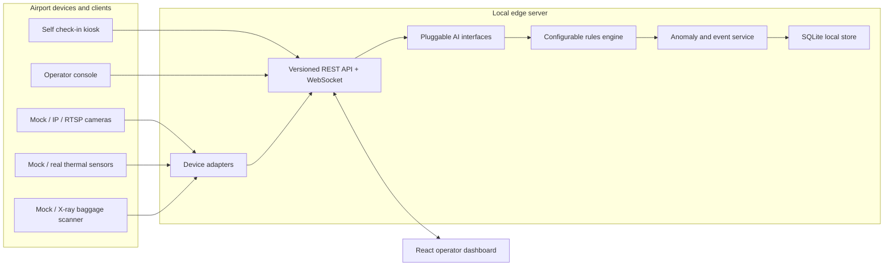

# Airport Edge AI Platform

A local-first simulation of an airport edge server. Device adapters, model interfaces, security rules, and API workflows are separate so mock inputs can be replaced without coupling hardware to passenger workflows.

## Project structure

```text
airport-edge-platform/
  backend/
    app/
      adapters/       Device adapter contracts and mock devices
      services/       Identity, check-in, AI, rules, events, devices, scans
      api.py          Versioned REST routes
      events.py       WebSocket event hub
      models.py       SQLite/PostgreSQL-compatible SQLAlchemy models
      schemas.py      Request and response validation
      main.py         FastAPI startup and local seeding
    examples/         Synthetic request payloads
    tests/            API integration and service tests
  frontend/
    src/              React/TypeScript operator dashboard
    Dockerfile
  docker-compose.yml
```

## File guide

### Backend

| File | What it contains |
| --- | --- |
| `backend/app/main.py` | Creates the FastAPI application, initializes local tables and demo data, configures CORS, and exposes the event WebSocket. |
| `backend/app/api.py` | Versioned HTTP endpoints for health, passenger identity, check-in, device scans, anomalies, metrics, devices, and rules. |
| `backend/app/config.py` | Reads database, CORS, thermal, and AI confidence settings from environment variables. |
| `backend/app/database.py` | Configures SQLAlchemy, provides request-scoped sessions, and migrates older rule tables. |
| `backend/app/models.py` | Defines persisted passenger, device, rule, scan, and event records. |
| `backend/app/schemas.py` | Defines Pydantic request and response validation types used by the API. |
| `backend/app/events.py` | Tracks WebSocket clients and publishes live event updates. |
| `backend/app/adapters/base.py` | Abstract interface for connecting to, reading from, and commanding hardware adapters. |
| `backend/app/adapters/mock.py` | Simulated camera, thermal, baggage scanner, and check-in kiosk adapters. |
| `backend/app/services/anomalies.py` | Normalizes, persists, and audit-logs anomaly events. |
| `backend/app/services/checkin.py` | Verifies identity and boarding-pass states and validates self check-in answers. |
| `backend/app/services/devices.py` | Seeds, registers, heartbeats, and expires device records. |
| `backend/app/services/models.py` | Pluggable vision, thermal, and anomaly model contracts with mock implementations. |
| `backend/app/services/passengers.py` | Seeds and queries synthetic passenger profiles. |
| `backend/app/services/rules.py` | Seeds, stores, and evaluates configurable object, baggage, thermal, zone, quantity, and passenger rules. |
| `backend/app/services/scans.py` | Records each processed scan for dashboard metrics. |
| `backend/examples/requests.json` | Copyable JSON requests for the main simulated workflows. |
| `backend/tests/test_platform.py` | API integration tests covering workflows, rules, devices, and multi-client WebSockets. |
| `backend/tests/test_units.py` | Focused tests for mock adapter lifecycle and model interfaces. |
| `backend/pytest.ini` | Configures pytest's import path and test discovery directory. |
| `backend/requirements.txt` | Runtime dependencies for the API server. |
| `backend/requirements-dev.txt` | Runtime dependencies plus the API test dependencies. |
| `backend/Dockerfile` | Builds and starts the backend container. |
| `backend/.dockerignore` | Keeps local databases, test files, and Python caches out of the API image. |

### Frontend and deployment

| File | What it contains |
| --- | --- |
| `frontend/src/App.tsx` | Dashboard state, API calls, simulations, event filters, and reusable display components. |
| `frontend/src/main.tsx` | Browser entry point that mounts the React dashboard and its styles. |
| `frontend/src/style.css` | Dashboard colors, layout, status styles, and responsive breakpoints. |
| `frontend/index.html` | HTML shell loaded by Vite. |
| `frontend/package.json` | Frontend dependencies and development/build commands. |
| `frontend/tsconfig.json` | Connects the TypeScript app and tooling configurations. |
| `frontend/tsconfig.app.json` | Strict TypeScript settings for the React application. |
| `frontend/tsconfig.node.json` | TypeScript settings for Vite's Node-side configuration. |
| `frontend/vite.config.ts` | Enables React support and proxies REST/WebSocket calls to the API. |
| `frontend/Dockerfile` | Builds the frontend bundle and serves it with the production Nginx image. |
| `frontend/.dockerignore` | Excludes local Node dependencies and previous build output from the image context. |
| `frontend/nginx.conf` | Serves the SPA and proxies REST, OpenAPI docs, and WebSocket traffic to the private API container. |
| `docker-compose.yml` | Runs the production API and dashboard with persistent local database storage. |
| `.gitignore` | Excludes generated Python, SQLite, Node, and build files. |
| `.env.example` | Documents optional Compose port and mock-policy settings. |

Python modules and classes also have docstrings; endpoint, service, adapter, test, and dashboard functions include short descriptions next to their definitions. Pydantic models describe the purpose of each request/response shape.

## Architecture



## Run locally

Backend (Python 3.11+):

```powershell
cd airport-edge-platform\backend
python -m venv .venv
.\.venv\Scripts\Activate.ps1
pip install -r requirements-dev.txt
uvicorn app.main:app --reload
```

The API and interactive docs are at `http://localhost:8000` and `/docs`. SQLite data is stored in `backend/airport_edge.db`. The server seeds synthetic passenger profiles and simulated devices on startup; no real identity information is used.

Frontend (Node.js 18+):

```powershell
cd airport-edge-platform\frontend
npm install
npm run dev
```

The Vite development server proxies `/api` and `/ws` to the backend. To run both production containers with Docker, from this directory run `docker compose up --build`; then open `http://localhost:8080`. The dashboard's Nginx proxy forwards API and WebSocket requests to the private backend container. Interactive API docs are available under `http://localhost:8080/docs`. Copy `.env.example` to `.env` to customize the loopback-only local port and mock-policy thresholds.

## Run temporarily in GitHub Codespaces

The repository-root `.devcontainer/devcontainer.json` configures Python and Node.js, installs both applications' dependencies when a Codespace is created, and forwards the dashboard and API ports privately. To start a demo:

1. Push the repository to GitHub, including the root `.devcontainer` configuration and `airport-edge-platform` directory.
2. On GitHub, open the repository and choose **Code → Codespaces → Create codespace on [branch]**. Wait for the initial dependency setup to finish.
3. In the Codespace terminal, start the API:

   ```bash
   cd airport-edge-platform/backend
   python -m uvicorn app.main:app --host 0.0.0.0 --port 8000
   ```

4. Open a second terminal and start the dashboard:

   ```bash
   cd airport-edge-platform/frontend
   npm run dev -- --host 0.0.0.0
   ```

5. Open the forwarded **Airport Edge Dashboard** port (5173) from the Codespaces **Ports** panel. The API port (8000) is also forwarded privately for `/docs`; the dashboard proxies its API and WebSocket requests to the API server.

This is a temporary development demo: both processes must remain running, and stopping or deleting the Codespace stops the app. Port access is private to your GitHub account by default. Use only the included synthetic passenger and device data; this prototype has no authentication and must not be exposed publicly or used with real personal/airport security data.

## Deploy on a VPS with Coolify

This repository includes a production-oriented Docker Compose deployment for an Ubuntu VPS running Coolify (or another Docker Compose manager):

1. Push the project to a GitHub repository.
2. In Coolify, create a Docker Compose application from that repository and select `airport-edge-platform/docker-compose.yml` as its Compose file.
3. Configure the `dashboard` service domain with container port `80` and enable HTTPS through Coolify's proxy. The optional Docker host-port mapping defaults to loopback (`127.0.0.1:8080`) and is for local access; Coolify should route to `dashboard:80` over the Compose network.
4. Deploy. The dashboard container serves the built React app and reverse-proxies `/api/`, `/docs`, `/openapi.json`, `/redoc`, and `/ws/events` to the API container over the private Compose network. Do not expose port `8000` publicly.
5. Keep the `edge-data` Docker volume attached to `/app/data`; this volume stores the SQLite database across redeploys. Back it up before replacing the VPS or removing the Compose volume.

`APP_PORT` (default `8080`), `THERMAL_THRESHOLD_C` (default `37.5`), and `AI_CONFIDENCE_THRESHOLD` (default `0.7`) can be set in the deployment environment. Use only synthetic demo records: this prototype has no authentication or authorization and is **not safe for public use with real passenger, identity, or aviation security data**. Add access control, TLS, backups, and an appropriate production database/security review before handling sensitive data.

## Example API requests

```powershell
# Identity detected is not the same as verified; match and boarding-pass flags are explicit.
Invoke-RestMethod -Method Post http://localhost:8000/api/v1/identity/verify `
  -ContentType 'application/json' `
  -Body '{"passenger_id":"PAX-10001","identity_detected":true,"mock_identity_match":true,"boarding_pass_present":true}'

Invoke-RestMethod -Method Post http://localhost:8000/api/v1/checkin/self `
  -ContentType 'application/json' `
  -Body '{"passenger_id":"PAX-10001","answers":[{"question":"What is your flight number?","answer":"AI123"},{"question":"What is your destination?","answer":"DEL"}]}'

Invoke-RestMethod -Method Post http://localhost:8000/api/v1/thermal/scan `
  -ContentType 'application/json' `
  -Body '{"device_id":"THERMAL-001","temperature_c":38.2}'

Invoke-RestMethod -Method Post http://localhost:8000/api/v1/baggage/scan `
  -ContentType 'application/json' `
  -Body '{"bag_id":"BAG-10001","passenger_id":"PAX-10001","scan_type":"XRAY","detections":[{"object_type":"mock_demo_restricted","confidence":0.91}]}'
```

Additional examples are in `backend/examples/requests.json`. Event consumers can connect to `ws://localhost:8000/ws/events`. Device clients can register through `POST /api/v1/devices` and update liveness through `POST /api/v1/devices/{device_id}/heartbeat`.

## Modules

- `app/api.py`: versioned REST and WebSocket routes.
- `app/models.py`, `app/database.py`: local SQLite persistence; the SQLAlchemy models are portable to PostgreSQL.
- `app/services/`: identity/check-in, AI abstractions, rules, and anomaly event handling.
- `app/adapters/`: mock camera, thermal, baggage, and kiosk adapter contracts.
- `frontend/`: React dashboard with event filters and scan/check-in simulations.
- `tests/`: service and API integration tests.

Security classifications are configurable and are not legal determinations. AI detections only trigger potential findings after a confidence threshold and matching enabled rule; findings require human review. Thermal output is not a medical diagnosis. This is a prototype, not a production identity or aviation security system.

Rules are managed with `GET /api/v1/rules` and `PUT /api/v1/rules`. Set `rule_type` to `OBJECT`, `BAGGAGE`, `SECURITY_ZONE`, `QUANTITY_LIMIT`, `THERMAL_THRESHOLD`, or `PASSENGER_VALIDATION`; use `conditions` for fields such as `{"zones":["SECURITY-ENTRY"]}`, `{"max_quantity":2}`, `{"threshold_c":37.5}`, or `{"question":"What is your passenger ID?","profile_field":"passenger_id"}`. Passenger answers are checked against the synthetic profile; rules may require additional profile-backed questions but cannot override those profile values.

## Run tests

```powershell
cd airport-edge-platform\backend
pip install -r requirements-dev.txt
pytest
```
